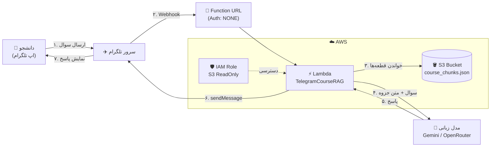
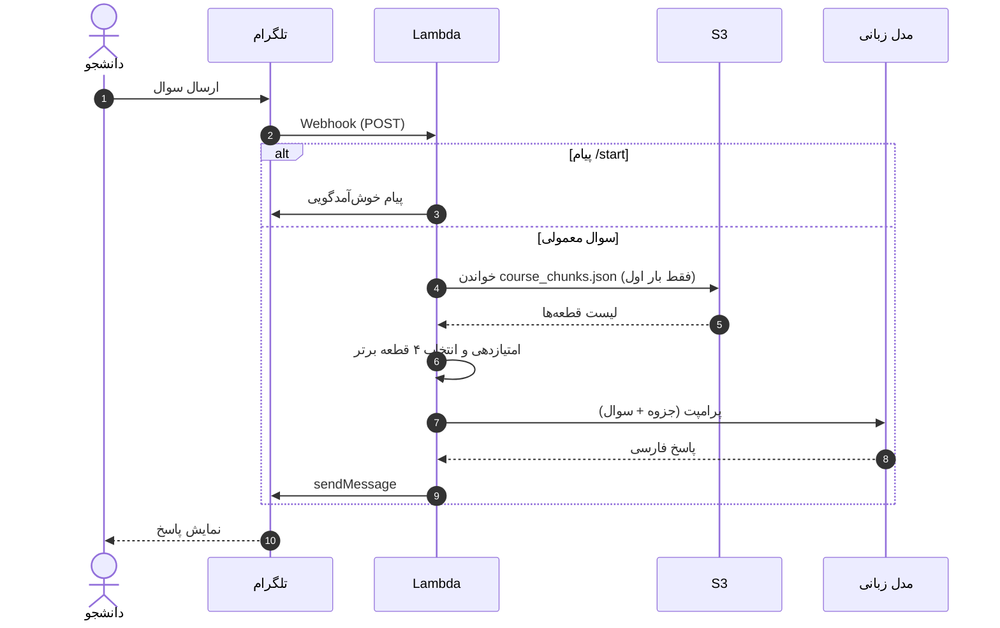

# 🤖 ربات تلگرام دستیار درس رایانش ابری (TelegramCourseRAG)

یک ربات تلگرام **سرورلس** که به سوال‌های دانشجو درباره جزوه‌های درس پاسخ می‌دهد. جزوه‌ها به قطعه‌های کوچک (chunk) تقسیم و در S3 ذخیره شده‌اند. برای هر سوال، مرتبط‌ترین قطعه‌ها پیدا می‌شوند و همراه سوال به یک مدل زبانی داده می‌شوند تا پاسخ فارسی همراه با نام فایل و شماره صفحه بسازد. این الگو همان **RAG** است.

---

## 📑 فهرست

1. [نمای کلی](#-نمای-کلی)
2. [دیاگرام معماری](#-دیاگرام-معماری)
3. [دیاگرام توالی یک سوال](#-دیاگرام-توالی-یک-سوال)
4. [مرحله ۱: ساخت ربات در تلگرام](#-مرحله-۱-ساخت-ربات-در-تلگرام)
5. [مرحله ۲: S3](#-مرحله-۲-s3)
6. [مرحله ۳: Lambda](#-مرحله-۳-lambda)
7. [مرحله ۴: تنظیمات تابع](#-مرحله-۴-تنظیمات-تابع)
8. [مرحله ۵: IAM](#-مرحله-۵-iam)
9. [مرحله ۶: وب‌هوک تلگرام](#-مرحله-۶-وبهوک-تلگرام)
10. [مرحله ۷: کد نهایی](#-مرحله-۷-کد-نهایی)
11. [نحوه کار RAG در این پروژه](#-نحوه-کار-rag-در-این-پروژه)
12. [نکات و بهبودها](#-نکات-و-بهبودها)

---

## 🧭 نمای کلی

| سرویس | نقش در پروژه |
|---|---|
| **تلگرام (BotFather)** | ساخت ربات و دریافت توکن |
| **S3** | نگه‌داری فایل جزوه‌ها (`course_chunks.json`) |
| **Lambda + Function URL** | دریافت پیام از تلگرام، جست‌وجو در جزوه و تولید پاسخ |
| **IAM** | مجوز خواندن از S3 برای تابع |
| **Gemini یا OpenRouter** | مدل زبانی که پاسخ نهایی را می‌نویسد |

---

## 🏗 دیاگرام معماری



---

## 🔁 دیاگرام توالی یک سوال



---

## 🟦 مرحله ۱: ساخت ربات در تلگرام

1. در تلگرام با **BotFather** گفتگو کنید و ربات جدید بسازید.
2. توکن ربات (`botToken`) را کپی و نگه دارید.

---

## 🪣 مرحله ۲: S3

1. یک Bucket با تنظیمات پیش‌فرض بسازید.
2. فایل‌های جزوه را آپلود کنید.
3. فایل `course_chunks.json` باید در ریشه Bucket باشد و ساختار زیر را داشته باشد:

```json
[
  {
    "source": "chapter1.pdf",
    "page": 3,
    "content": "متن همان صفحه یا بخش از جزوه..."
  }
]
```

> کد، فیلدهای `source`، `page` و `content` را می‌خواند.

---

## ⚡ مرحله ۳: Lambda

1. **Create function** را بزنید.
2. نام تابع: `TelegramCourseRAG`
3. Runtime: **Python 3.12**
4. گزینه **Enable function URL** را فعال کنید.
5. در **Auth type** حتماً **NONE** را انتخاب کنید (تلگرام باید بتواند بدون احراز هویت AWS آدرس را صدا بزند).
6. بعد از ساخت، **Function URL** را کپی کنید.

---

## ⚙️ مرحله ۴: تنظیمات تابع

### افزایش حافظه و زمان اجرا

مسیر: **Configuration → General configuration → Edit**

| تنظیم | مقدار |
|---|---|
| حافظه (Memory) | `512 MB` |
| زمان اجرا (Timeout) | `1 min 0 sec` |

### متغیرهای محیطی

مسیر: **Configuration → Environment variables → Edit → Add environment variable**

| کلید | مقدار |
|---|---|
| `TELEGRAM_TOKEN` | توکنی که از BotFather گرفتید |
| `S3_BUCKET_NAME` | نام دقیق Bucket (مثلاً `cloud-course-rag-amin-2026`) |
| `GEMINI_API_KEY` | کلید Google AI Studio (اگر دارید) |
| `OPENROUTER_API_KEY` | کلید OpenRouter (به‌جای کلید Gemini) |

> فقط یکی از دو کلید مدل زبانی کافی است. اگر هر دو وارد شوند، Gemini اولویت دارد.

---

## 🛡 مرحله ۵: IAM

1. در **Configuration → Permissions** روی لینک آبی زیر **Role name** کلیک کنید.
2. در صفحه IAM گزینه **Add permissions → Attach policies** را بزنید.
3. این دو Policy را جست‌وجو و تیک بزنید:
   - `AmazonS3ReadOnlyAccess`
   - `AmazonBedrockFullAccess`
4. روی **Add permissions** بزنید و به Lambda برگردید.

> کد فعلی از Bedrock استفاده نمی‌کند و فقط به دسترسی S3 نیاز دارد. Policy مربوط به Bedrock برای حالتی است که بخواهید بعداً مدل را از Bedrock صدا بزنید.

---

## 🔗 مرحله ۶: وب‌هوک تلگرام

این کار را در مرورگر انجام دهید (حدود ۳۰ ثانیه). آدرس زیر را بسازید و در مرورگر باز کنید:

```text
https://api.telegram.org/bot<YOUR_BOT_TOKEN>/setWebhook?url=<YOUR_LAMBDA_URL>
```

- به‌جای `<YOUR_BOT_TOKEN>` توکن ربات را بگذارید.
- به‌جای `<YOUR_LAMBDA_URL>` همان Function URL مرحله ۳ را بگذارید.

اگر پاسخ شامل `"ok": true` بود، اتصال برقرار شده است.

---

## 🧩 مرحله ۷: کد نهایی

در تب **Code** کد قبلی را با کد زیر جایگزین و **Deploy** کنید:

```python
import json
import os
import re
import urllib.request
import boto3

s3_client = boto3.client('s3')

TELEGRAM_TOKEN = os.environ.get('TELEGRAM_TOKEN')
BUCKET_NAME = os.environ.get('S3_BUCKET_NAME')
GEMINI_API_KEY = os.environ.get('GEMINI_API_KEY')
OPENROUTER_API_KEY = os.environ.get('OPENROUTER_API_KEY')
CHUNKS_FILE_KEY = 'course_chunks.json'

cached_chunks = None

def send_telegram_message(chat_id, text):
    url = f"https://api.telegram.org/bot{TELEGRAM_TOKEN}/sendMessage"
    payload = json.dumps({"chat_id": chat_id, "text": text}).encode('utf-8')
    req = urllib.request.Request(url, data=payload, headers={'Content-Type': 'application/json'})
    urllib.request.urlopen(req, timeout=10)

def load_chunks_from_s3():
    global cached_chunks
    if cached_chunks is not None:
        return cached_chunks

    # خواندن مستقیم فایل جزوات از باکت Amazon S3
    obj = s3_client.get_object(Bucket=BUCKET_NAME, Key=CHUNKS_FILE_KEY)
    cached_chunks = json.loads(obj['Body'].read().decode('utf-8'))
    return cached_chunks

def tokenize(text):
    # استخراج کلمات فارسی و انگلیسی برای الگوریتم امتیازدهی در RAG
    return set(re.findall(r'\w+', text.lower()))

def retrieve_top_k(question, k=4):
    chunks = load_chunks_from_s3()
    q_words = tokenize(question)

    scored_chunks = []
    for chunk in chunks:
        c_words = tokenize(chunk['content'])
        # محاسبه میزان اشتراک معنایی و واژگانی سوال با هر صفحه از جزوه
        overlap = len(q_words.intersection(c_words))
        scored_chunks.append((overlap, chunk))

    scored_chunks.sort(key=lambda x: x[0], reverse=True)
    return [item[1] for item in scored_chunks[:k]]

def generate_rag_answer(question, top_chunks):
    context_text = "\n\n---\n\n".join(
        [f"منبع: فایل {c['source']} (صفحه {c['page']}):\n{c['content']}" for c in top_chunks]
    )

    prompt = (
        f"شما دستیار هوشمند درس رایانش ابری هستید. بر اساس «متن جزوه» زیر به «سوال دانشجو» به زبان فارسی دقیق و علمی پاسخ دهید. "
        f"در انتهای پاسخ خود، نام فایل و شماره صفحه‌ای که جواب را از آن استخراج کردید ذکر کنید.\n\n"
        f"متن جزوه:\n{context_text}\n\n"
        f"سوال دانشجو: {question}"
    )

    # حالت اول: اگر کلید Gemini وارد شده باشد
    if GEMINI_API_KEY:
        url = f"https://generativelanguage.googleapis.com/v1beta/models/gemini-2.5-flash:generateContent?key={GEMINI_API_KEY}"
        payload = json.dumps({
            "contents": [{"parts": [{"text": prompt}]}]
        }).encode('utf-8')
        req = urllib.request.Request(url, data=payload, headers={'Content-Type': 'application/json'})
        with urllib.request.urlopen(req, timeout=25) as res:
            result = json.loads(res.read().decode('utf-8'))
            return result['candidates'][0]['content']['parts'][0]['text']

    # حالت دوم: اگر کلید OpenRouter وارد شده باشد
    elif OPENROUTER_API_KEY:
        url = "https://openrouter.ai/api/v1/chat/completions"
        payload = json.dumps({
            "model": "google/gemini-2.5-flash",
            "messages": [{"role": "user", "content": prompt}]
        }).encode('utf-8')
        headers = {
            'Content-Type': 'application/json',
            'Authorization': f'Bearer {OPENROUTER_API_KEY}'
        }
        req = urllib.request.Request(url, data=payload, headers=headers)
        with urllib.request.urlopen(req, timeout=25) as res:
            result = json.loads(res.read().decode('utf-8'))
            return result['choices'][0]['message']['content']

    else:
        return "خطا: لطفاً متغیر GEMINI_API_KEY یا OPENROUTER_API_KEY را در تنظیمات Environment Variables تابع Lambda وارد کنید."

def lambda_handler(event, context):
    try:
        body = json.loads(event.get('body', '{}'))
        if 'message' not in body or 'text' not in body['message']:
            return {'statusCode': 200, 'body': 'OK'}

        chat_id = body['message']['chat']['id']
        user_text = body['message']['text'].strip()

        if user_text == '/start':
            send_telegram_message(chat_id, "سلام! من دستیار ابری درس هستم (مستقر روی AWS Lambda و S3). هر سوالی از جزوات درس دارید بپرسید!")
            return {'statusCode': 200, 'body': 'OK'}

        # ۱. بازیابی صفحات مرتبط جزوه از باکت Amazon S3
        top_chunks = retrieve_top_k(user_text, k=4)

        # ۲. تولید پاسخ نهایی بر اساس صفحات پیدا شده
        answer = generate_rag_answer(user_text, top_chunks)

        # ۳. ارسال پاسخ به تلگرام
        send_telegram_message(chat_id, answer)

        return {'statusCode': 200, 'body': 'OK'}

    except Exception as e:
        print(f"Error: {str(e)}")
        return {'statusCode': 200, 'body': 'Error handled'}
```

---

## 🔍 نحوه کار RAG در این پروژه

| مرحله | توضیح |
|---|---|
| **بارگذاری** | فایل `course_chunks.json` یک بار از S3 خوانده و در متغیر سراسری نگه داشته می‌شود تا درخواست‌های بعدی سریع‌تر باشند |
| **بازیابی** | سوال و هر قطعه به مجموعه کلمات تبدیل می‌شوند و تعداد کلمات مشترک، امتیاز قطعه است |
| **انتخاب** | چهار قطعه با بیشترین امتیاز انتخاب می‌شوند |
| **تولید** | قطعه‌ها، نام فایل و شماره صفحه همراه سوال در یک پرامپت فارسی به مدل داده می‌شوند |
| **ارسال** | پاسخ مدل با `sendMessage` به کاربر برمی‌گردد |

---

## 💡 نکات و بهبودها

- **خطای ۲۰۰:** تابع در هر حالت، حتی هنگام خطا، کد `200` برمی‌گرداند. این کار باعث می‌شود تلگرام پیام را بارها دوباره ارسال نکند.
- **جست‌وجوی واژگانی:** امتیازدهی فقط بر اساس کلمات مشترک است و معنا را نمی‌فهمد. کلمات پرتکرار فارسی مثل «از» و «که» هم امتیاز می‌دهند؛ حذف این کلمات (stop words) نتیجه را بهتر می‌کند. برای کیفیت بالاتر می‌توان از embedding استفاده کرد.
- **امنیت Function URL:** چون Auth روی NONE است، هر کسی که آدرس را بداند می‌تواند آن را صدا بزند. تلگرام می‌تواند هنگام `setWebhook` پارامتر `secret_token` بفرستد و تابع هدر `X-Telegram-Bot-Api-Secret-Token` را بررسی کند.
- **کلیدها:** کلید مدل زبانی در متغیر محیطی ذخیره شده است. برای پروژه جدی‌تر، AWS Secrets Manager گزینه امن‌تری است.
- **سقف پیام تلگرام:** هر پیام حداکثر حدود ۴۰۹۶ کاراکتر می‌تواند باشد. پاسخ‌های خیلی بلند باید به چند پیام تقسیم شوند.
- **دسترسی‌ها:** `AmazonBedrockFullAccess` در کد فعلی استفاده نمی‌شود و می‌توان آن را برداشت.
